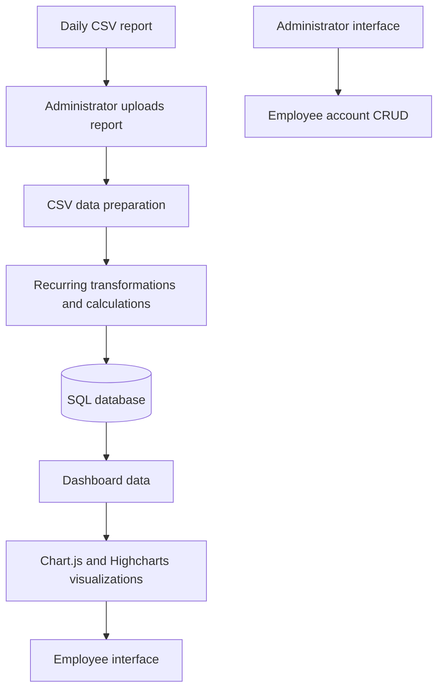

# Application architecture

## High-level workflow

## Import and preparation

The administrator initiates the import from the application. The imported CSV data goes through a recurring preparation process before database insertion. The described transformations include removing unnecessary columns, splitting selected columns, combining selected columns, and applying recurring calculations.

Exact business rules, field names, database schema, and implementation details are intentionally omitted.

## Interfaces
- **Administrator interface:** employee account management and daily report import.
- **Employee interface:** access to dashboards and visualizations.

This diagram is a high-level conceptual representation, not a disclosure of the internal production architecture.
